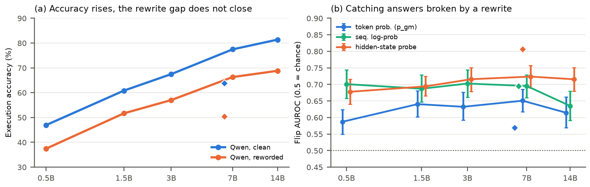

# Progress update (Checkpoint 2): does an NL2SQL model's confidence track failures caused by meaning-preserving rewrites?

ECE/CS 559, Abhishek and Shubham Harale, Nov 5, 2026. Code: (GitHub link to be added)

**Setup.** Dr.Spider NLQ sets (9 rewrite types): 7,593 clean/reworded question pairs with identical gold SQL, from 1,020 Spider-dev questions. Six models (Qwen2.5-Coder 0.5B to 14B, DeepSeek-Coder-6.7B), greedy decoding. Labels: execution match on the Spider DB (EX) and test-suite match on ~30 to 60 DB variants (TS). A *flip* is a pair right on the clean question and wrong on its rewrite; *flip AUROC* asks whether the confidence drop ranks flips above survivors. 95% CIs: cluster bootstrap over clean questions.

## Results so far

| Model | EX clean → reworded | TS clean → reworded | Flip AUROC p_gm | Flip AUROC probe | ECE Platt clean → rew. |
|---|---|---|---|---|---|
| Qwen-0.5B | 46.9 → 37.4% | 39.3 → 29.8% | 0.59 [0.55, 0.62] | 0.68 [0.64, 0.72] | 0.037 → 0.072 |
| Qwen-1.5B | 60.8 → 51.7% | 50.8 → 41.3% | 0.64 [0.60, 0.68] | 0.69 [0.67, 0.72] | 0.037 → 0.105 |
| Qwen-3B | 67.5 → 57.0% | 59.5 → 47.9% | 0.63 [0.59, 0.68] | 0.72 [0.68, 0.75] | 0.030 → 0.091 |
| Qwen-7B | 77.5 → 66.3% | 70.9 → 57.3% | 0.65 [0.62, 0.69] | 0.72 [0.69, 0.76] | 0.049 → 0.115 |
| DeepSeek-6.7B | 63.8 → 50.4% | 56.6 → 41.6% | 0.57 [0.53, 0.60] | 0.81 [0.78, 0.83] | 0.047 → 0.135 |
| Qwen-14B | 81.4 → 68.8% | 73.0 → 59.0% | 0.61 [0.57, 0.66] | 0.72 [0.68, 0.75] | 0.015 → 0.118 |

Lines: Qwen2.5-Coder; diamonds: DeepSeek-Coder-6.7B. Error bars: 95% CI. Labels: EX. Flip AUROC uses the drop in confidence from clean to reworded.

- **Scale buys accuracy, not robustness.** Rewording costs 9.2 to 13.4 EX points at every size (14B: 12.6 [10.7, 14.6]); under TS labels the cost is 9.4 to 15.0.
- **Token confidence barely notices a broken answer.** Flip AUROC of p_gm is 0.57–0.65, with no gain from 7B to 14B; in 25 to 37% of flips confidence did not drop at all.
- **Hidden states carry the missing signal.** A linear probe on decoder states, fit on clean questions only and scored on held-out databases, reaches 0.68–0.81 and beats p_gm for every model (10 to 19% of flips missed). The pre-set layer (75% depth, mean over SQL tokens) was the best of 6 choices for 5 of 6 models.
- **Calibration fit on clean data degrades under rewording.** Platt scaling brings ECE to 0.015–0.049 on clean questions but 0.072–0.135 on rewrites (14B: 0.015 → 0.118).
- **Sampling (7B, k = 10) ranks answers better but not flips.** Agreement of execution results: AUROC 0.828 clean / 0.725 reworded vs p_gm 0.719 / 0.607; flip AUROC 0.631 vs 0.623.

## Problems encountered

- **Compute.** The EC2 instance was unavailable; we moved to a Colab A100 (80 GB) driven from the Colab CLI, with a resumable pipeline (stage markers, per-batch writes). Full run: 2.3 h.
- **Lucky matches.** Single-DB EX overstates clean accuracy by 6.5 to 10.1 points vs TS, so we report both labels.
- **Dependent pairs.** One clean question has up to 37 rewrites (median 6), so pair-level tests overstate certainty; all CIs resample clean questions.
- **Confounds.** Sequence log-prob is a sum, and output-length change alone gives flip AUROC 0.55 to 0.66; its edge over p_gm is partly length. Agreement over k = 10 samples is coarse, so many flips tie at zero change.
- **Degenerate decoding.** The CPU pilot looped to the token cap in 2.5% of outputs; a repetition guard now keeps unfinished outputs at 1% or less.

## Experiments that remain

- Length-controlled confidence (per-token and length-matched comparisons) for seq. log-prob and the probe.
- Probe transfer: train on some rewrite types, test on others; add Dr.Spider DB and SQL perturbation families.
- Tie-aware sampling analysis with larger k and a second model; manual audit of ~100 flips for rewrites that change meaning.
- Final presentation (Dec 1 or 3) and paper with code (Dec 4).
